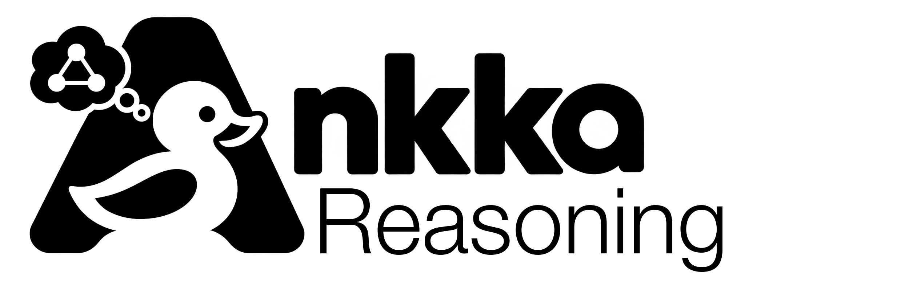

<picture>
  <source media="(prefers-color-scheme: dark)" srcset="docs/assets/brand/ankka-reasoning-lockup-white.png">
  
</picture>

[](https://github.com/thinkmorestupidless/ankka-reasoning/actions/workflows/ci.yml) [](LICENSE)

[](docs/get-started/run-locally.md) [](https://central.sonatype.com/artifact/com.thinkmorestupidless/ankka-reasoning-graph_3) [](https://github.com/thinkmorestupidless/ankka-reasoning/pkgs/container/ankka-reasoning)

A reasoning graph on [ankka](https://github.com/thinkmorestupidless/ankka): a record of how beliefs
form and change. Evidence is kept with where it came from, claims are derived from evidence,
hypotheses compete to answer a question, and a belief is one holder's probability for one
hypothesis. Nothing in it is ever edited, so any belief can be traced to its sources, read back as
it stood on any past day, and set beside a belief that disagrees with it.

**Documentation: [reasoning.ankka.cloud](https://reasoning.ankka.cloud/).**

**Two features are built.** The belief layer and the market layer are recorded, published to the
graph and explained; and the process layer records how: the service carries one blueprint, the
appraiser, runs it on ankka's agent runtime, and holds every record a run writes with the act
that says which run, step and worker wrote it. Every scenario under [`features/`](features) is run
by a test. Release 0.1.1 carries the first feature; the process layer runs from the repository
until the next. See [Running it](#running-it).

## The problem

A forecast, a recommendation or a decision usually survives as a number or a sentence. The
reasoning that produced it does not. That is true of a person's judgement, of a market's price,
and most of all of an agent's answer, where the reasoning lived in a prompt and was gone when the
call returned.

Three questions then have no answer:

- **Where did this come from?** Which claims does the belief rest on, what evidence are they
  derived from, and who published it.
- **What did we believe then?** What the belief was last Tuesday, what evidence had been seen by
  then, and what arrived afterwards.
- **Why do these two disagree?** Whether two holders saw different evidence, or weighed the same
  evidence differently.

Asking a model afterwards does not answer them. It writes a plausible argument at the moment it is
asked, which is not the argument that was made.

A prediction market shows the gap plainly, and it is the first domain this is built for. A market
says the crowd puts an outcome at 38%. It does not say why, and when the price moves to 61% nothing
in the market says what changed. A forecaster beside the market, human or agent, has the same
problem unless its reasoning is recorded as it happens.

## What this does

ankka-reasoning records the reasoning as it is stated, checks it, and keeps it as a graph that can
be asked those three questions.

![How ankka-reasoning works. Writers, a person, a script or a test, send records to the ankka-reasoning service, which runs in an ankka project; and a run of the appraiser blueprint, hosted by the service on ankka's agent runtime, writes records through its tools, each with an act. Inside the service, Records holds one entity per record, never edited, and checks every rule against the service's own records; every record is kept in the service's Postgres database. Each change goes to the graph consumers, one per kind of record, which turn each record into a node and each link it stated into an edge and publish them as graph deltas to a compacted delta topic in Kafka under the contract ankka.graph-delta.v1. The graph sink, a second service in the same project that runs ankka's graph sink over ankka-contrib's Neo4j store, reads the topic and merges each delta into the graph database, Neo4j, which is a copy that can be emptied and rebuilt from the topic alone. Readers ask the service's Answers, which query the graph database, read only, and reply with records only. A write never waits for the graph.](docs/assets/diagrams/architecture.svg)

It is an ankka application with four parts:

- **Records.** Each question, piece of evidence, claim and belief revision is an ankka entity. A
  writer sends a record; the service checks it against the records it already holds and either
  keeps it or refuses it, naming the rule. A claim must name evidence that is held. A belief
  revision cannot rest on a claim dated later than itself. Nothing held is changed afterwards.
- **Graph consumers.** Every record is published as a node, and every link it stated as an edge,
  using ankka's [graph consumers](https://docs.ankka.cloud/build/graph/). The deltas go to a
  compacted topic, and ankka's [graph sink](https://docs.ankka.cloud/deploy/graph-sink/), run from
  [ankka-contrib](https://github.com/thinkmorestupidless/ankka-contrib)'s Neo4j image, applies them
  to Neo4j. The graph database is a copy: it can be emptied and rebuilt from the topic alone.
- **Runs.** The service hosts a blueprint, the appraiser, on ankka's
  [agent runtime](https://docs.ankka.cloud/build/blueprints/): two workers, six steps, a critique
  that can fail the run. Its workers write through three tools the service gives it, each tool
  writing a record under the same rules as a request would and then the record's act: which run,
  of which version of the blueprint, in which step, as which worker. A record a person wrote has
  no act.
- **Answers.** A reader asks why a belief changed, what the case for a hypothesis is, what was
  believed as of a date, or where two holders differ. Each answer is a walk of the graph and is
  made of records only. No sentence is written for the occasion. Every answer can be asked with the
  acts behind it, and one more says what a run wrote.

## What the graph holds

![The kinds of node in the graph and the links between them, in two layers. In the belief layer: a hypothesis answers a question; evidence is from a source; a claim derives from evidence, supports or contradicts a hypothesis, is stated by a holder, and may revise an earlier claim; a belief revision is in a hypothesis with a probability, rests on claims each with an optional weight, is held by a holder, and follows the belief revision before it. In the market layer, above: a market is about a question, offers an outcome for a hypothesis, and speaks as a holder; a resolution is of a market, resolves to a hypothesis, is on evidence, and may revise an earlier resolution. Every arrow is a link stated by the record it leaves and points to a record that was already held. No record is ever edited.](docs/assets/diagrams/graph.svg)

The vocabulary is in layers, and each layer can be used without the ones above it.

| Layer | Kinds of node | What it is for |
|---|---|---|
| Belief | question, hypothesis, holder, source, evidence, claim, belief revision | Reasoning about anything not yet known. It names nothing of markets. |
| Market | market, resolution | A question that is traded. The market is a holder too, and each price observation is its belief revision. |
| Process | blueprint version, run, run ending, act | Which run of which version of a blueprint wrote a record, in which step, as which worker. Drawn on [its own page](docs/concepts/process-layer.md). |

Reading the picture from a belief revision outwards gives the trace that makes a belief auditable:
the claims it rests on, the evidence each derives from, and the source of that evidence. One step
further, through the act, is the run that wrote it and the instructions it followed.

## How it stays right

Five rules do most of the work. Each one removes a problem instead of handling it.

- **Nothing is edited.** A holder who thinks again states a new record linked to the old one: a
  claim that revises a claim, a belief revision that follows the one before. History is not
  reconstructed, because it was never overwritten. The one exception is text that has to come out:
  the excerpt of a piece of evidence or the statement of a claim can be withdrawn for good, and the
  record, its links and its dates stay, so every trace through it still holds.
- **Links point backwards.** A record may link only to records that are already held and dated no
  later than itself. A cycle cannot be made, so nothing has to check for one, and no record can
  rest on something that had not happened yet.
- **A link has one owner.** Every link is stated by one record, the newer of the two it joins, and
  published with it. No node or edge has two writers, which is the rule ankka's graph deltas need.
- **Rules are checked where the truth is.** Whether a record may be held is decided from the
  service's own records. The graph database is always a moment behind, so it is only ever read.
- **Answers are records.** An explanation contains the claims, evidence and sources that are held
  and nothing else, so it can be checked against the graph by anyone.
- **A record has one act, written with it.** A tool writes the record, then its act, and answers
  the model only after both; a refused record leaves nothing. A record keeps its first act, so the
  answer to what a run wrote is exact.

## An example

Will Company X launch Product Y this year? Every name and number here is made up.

```text
4 May    evidence   a filing, from "Company X filings"
         claim      "approval is pending and the launch date is uncertain"
                      derives from the filing · contradicts "it launches this year"
         belief     agent-a puts "it launches this year" at 0.38, resting on that claim

11 May   evidence   a notice, from "the regulator"
         claim      "the approval barrier has gone"
                      derives from the notice · supports "it launches this year"
                      revises the claim of 4 May
         belief     agent-a moves to 0.61, resting on the new claim
                      follows the belief revision of 4 May
```

The claim of 4 May is kept. It was right for its time.

Asked why the belief went from 0.38 to 0.61, the graph answers with the regulator's notice, the
claim derived from it and the earlier claim it revised, each with its source. Asked what agent-a
believed as of 6 May, it answers 0.38, resting on the first claim, with the notice absent because
it had not been observed. If a market prices the same outcome at 0.48, the comparison gives 0.48
against 0.61, the claims agent-a rests on, and the market stating no reasons.

## From a record to the graph

![The path of one change. A writer sends a record, here POST /claims, and is answered once the record is held. Inside the ankka-reasoning service the record is one entity, which checks every rule and is kept in the service's Postgres database: a key value record's state, or a belief's events. Each change, the new state or a new event at sequence number n, is polled from the database once a second and handed at least once to the graph consumer for that kind of record, which builds the record's node and an edge for each link the record stated, through the vocabulary. ankka publishes each element as one graph delta to the compacted Kafka topic reasoning-graph, keyed by the element, carrying version n and the element's whole state. The graph sink, a service of its own, applies a delta only when its version is newer than what Neo4j holds, merging the element by its key. The worked example: the claim launch.barrier-gone, stated by agent-a, deriving from a notice, supporting the hypothesis launch/yes and revising the claim launch.pending, becomes five deltas: the claim's node and four edges, all at the claim's version. In Neo4j each edge leaves the claim and points to a node that was already held, published by its own record. Withdrawing the statement later is a new change: the same five keys at a newer version, the node without its text; the sink replaces the node's properties whole, and compaction drops the older delta from the topic.](docs/assets/diagrams/pipeline.svg)

The claim of 11 May, written once, becomes five graph deltas: its node and an edge for each link it
stated. ankka hands every change to the graph consumer for that kind of record, at least once;
the consumer builds the elements through the vocabulary; ankka publishes each one keyed by the
element, at the change's version and with its whole state. The graph sink applies a delta only
when it is newer than what Neo4j holds, so a change handled twice changes nothing, and Neo4j can be
emptied and filled again from the topic alone.

## How it runs

![ankka-reasoning deploys as two services in one ankka project. You or a CI job use the ankka CLI, through the installation's gateway, to create the project, declare the delta topic, set the secret and apply the two descriptors each release attaches; the control plane and the operator create and own each service's Deployment, database and route. The service reasoning is one image, a Scala service of one or more JVM instances forming one Pekko cluster, with the layers compiled in: graph, belief, market and process, composed by the service module; the layers are also published as libraries. Running, it has graph consumers, HTTP endpoints on port 9000, one entity per record, and answers. Its records are kept in its own database in the project's Postgres. Its graph consumers publish deltas to the topic reasoning-graph in the installation's Kafka, declared on the project and compacted. The second service, reasoning-graph-sink, is ankka's graph sink in ankka-contrib's image, with no HTTP, no database and no code of ankka-reasoning in it: it reads the topic and merges each delta into Neo4j 5.26 or later, which you provide where the project can reach it. Both read the Neo4j credentials from the project secret reasoning-graph. The service's answers read Neo4j over Bolt, read only. People reach the service through the gateway at its exposed hostname with a token from an issuer the service lists; another ankka service reaches it in the cluster over mutual TLS and writes as service, its project and name. Readers with a Cypher client query Neo4j directly, read only.](docs/assets/diagrams/deployment.svg)

Two services in one ankka project. `reasoning` is this repository: one image with the layers
compiled in, its records in its own Postgres database. `reasoning-graph-sink` is ankka's graph sink in
[ankka-contrib](https://github.com/thinkmorestupidless/ankka-contrib)'s image, with nothing of this
repository in it; the topic between them is the only thing they share. Kafka is the installation's
and Neo4j is yours. People write through the gateway with a token, other ankka services call it
over mutual TLS, and anyone with a Cypher client can read the graph directly; nobody writes to it but
the sink.

## What is here now

| | |
|---|---|
| [`specs/001-belief-layer/`](specs/001-belief-layer), [`specs/002-process-layer/`](specs/002-process-layer) | The two features: each its spec, plan, contracts, and in `research.md` every decision and what building it found. |
| [`features/`](features) | What the service does, as scenarios in five areas: `record`, `graph`, `explain`, `market`, `process`. The specs name them and a suite runs each. |
| [`GLOSSARY.md`](GLOSSARY.md) | The words the scenarios use, each in one sense. |
| [`modules/graph`](modules/graph) | The vocabulary as a value, the only way to build an element, and the reader of the graph database. |
| [`modules/belief`](modules/belief) | The belief layer: its records as ankka entities, its rules, its graph consumers, its answers and its routes. It names nothing of markets, and the build holds it to that. |
| [`modules/market`](modules/market) | The market layer, built on the belief layer and changing nothing in it. |
| [`modules/process`](modules/process), [`golden-set/`](golden-set) | The process layer: acts, runs, versions, the three tools, the appraiser as data, and the golden set of eight documents it is proved against. |
| [`modules/service`](modules/service) | The one deployable: the three layers composed, the providers read from the environment, and the suites that run the features. |
| [`modules/seed`](modules/seed), [`seed/`](seed) | A client of the service: the worked example and a generated set of ten questions as seed files, and the tools that measure. |
| [`deploy/`](deploy), [`docker-compose.yml`](docker-compose.yml) | The service's and the graph sink's descriptors for a cluster, and what stands in for a cluster on a laptop. |
| [`docs/`](docs), [`mkdocs.yml`](mkdocs.yml) | The documentation, published at [reasoning.ankka.cloud](https://reasoning.ankka.cloud/) and rendered as an agent skill under [`marketplace/`](marketplace). Built by ankka's docs tool: `just docs`. |
| [`.github/workflows/release.yml`](.github/workflows/release.yml) | What a `v*` tag publishes: the four layer modules to Maven Central, the service's image to `ghcr.io/thinkmorestupidless/ankka-reasoning`, the plugin to the ankka marketplace, and a release page. Release 0.1.1 is the latest; it predates the process layer. |
| [`notes/ankka-requests.md`](notes/ankka-requests.md) | What this application asks of ankka and its siblings, and what each request would remove here. |
| [`CLAUDE.md`](CLAUDE.md) | The working rules for the repository and its commands. |

## Running it

JDK 21, sbt, Docker and `just`. ankka 0.12.0 comes from Maven Central, and the graph sink's image,
`ghcr.io/thinkmorestupidless/ankka-graph-sink-neo4j:0.1.0`, from `ghcr.io`.

```bash
just up                      # Postgres, Kafka with the compacted topic, Neo4j, the graph sink
just run                     # the service on :9000
just seed launch-example     # the example above, as records
curl -s localhost:9000/graph/wait -d '{"kind":"revision","id":"agent-a.launch.2"}'
curl -s 'localhost:9000/answers/belief-change?from=agent-a.launch.1&to=agent-a.launch.2'
```

The last answers with 0.38 and 0.61, the claim newly rested on with the regulator's notice and its
source, and the earlier claim no longer rested on and revised by it.

A run of the appraiser needs a model: `ANTHROPIC_API_KEY` and `TYPESAFE_API_KEY` in the environment
of `just run`. With them, the golden set's four runs, two holders over two months with a second
set of instructions for the second holder:

```bash
just seed golden-set         # the question, its sources and its market
curl -s localhost:9000/process/runs -d '{"blueprint":"appraiser","runId":"appraiser-a-may","input":{"tranche":"may","holder":"appraiser-a","question":"launch","observedAt":"2026-05-31T09:00:00Z"}}'
curl -s localhost:9000/process/runs/appraiser-a-may                     # until "ending" appears
curl -s 'localhost:9000/process/answers/belief-change?from=appraiser-a-may.yes&to=appraiser-a-june.yes'
just measure-golden-set      # the four runs timed: each record to the graph with its act, the whole set
```

Without the keys, every run ends `failed` naming the key, and everything else works. `just test`
runs every suite, with a scripted model in place of the real one; the quickstarts of
[the first feature](specs/001-belief-layer/quickstart.md) and
[the second](specs/002-process-layer/quickstart.md) walk through what each tier proves and what was
measured.

## What comes next

The appraiser reads documents it is given and records which run wrote what; it gathers nothing,
and the conversation that led to a record is not a record. What follows, in the order it is
expected:

1. A release carrying the process layer, and the appraiser proved against a real model over
   repeated runs rather than once.
2. Blueprints that gather evidence from outside the golden set, and more than one of them.
3. Beliefs that know when to think again: a belief resting on a revised claim is marked and
   revisited.
4. Scoring: once a market resolves, which holders, which evidence and which version of the
   instructions were worth listening to.

## Beside ankka and ankka-contrib

ankka-reasoning is an application of ankka and part of neither. ankka supplies the entities, the
graph consumers, the delta contract, the graph sink, and the agent runtime that holds the blueprint
and runs it. ankka-contrib supplies the Neo4j store the sink writes through, as a ready image. What
this project finds missing in either becomes a request to it.

## Licence

[Apache 2.0](LICENSE), as ankka and ankka-contrib are.
